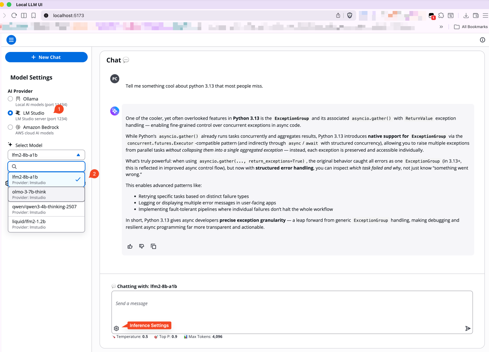
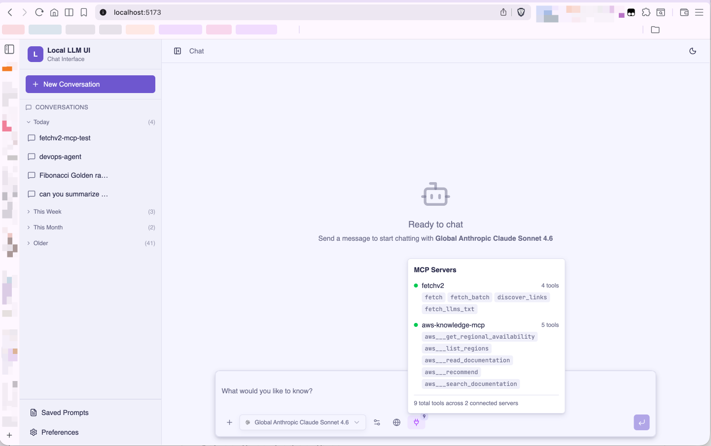
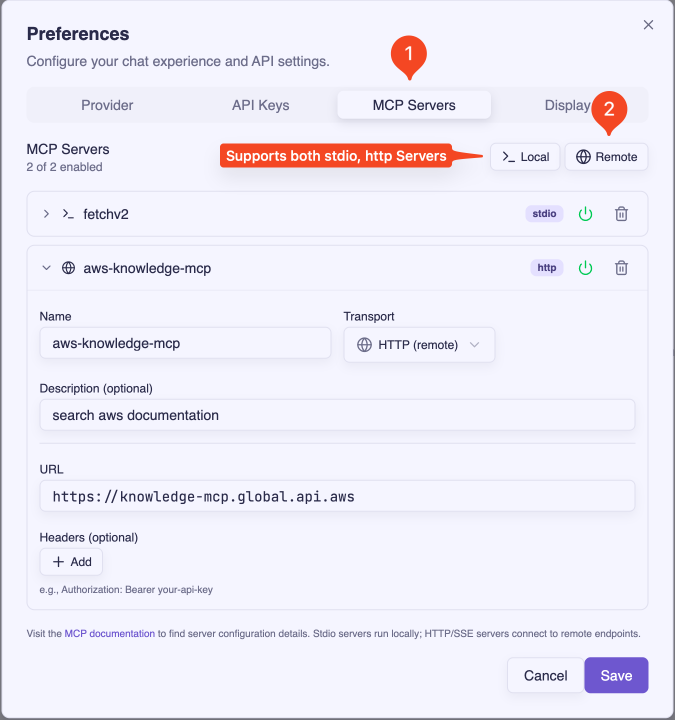

# Local LLM UI

[](https://opensource.org/licenses/MIT)
[](https://www.typescriptlang.org/)
[](https://reactjs.org/)
[](https://vitejs.dev/)
[](CONTRIBUTING.md)

Local LLM UI is a chat app for large language models. It runs on your computer and connects to local models (Ollama, LM Studio) and cloud models (Amazon Bedrock, Anthropic, Groq, and more) from one window.



## Contents

- [Features](#features)
- [Quick start](#quick-start)
- [Connect a provider](#connect-a-provider)
- [Use the app](#use-the-app)
- [Troubleshooting](#troubleshooting)
- [Development](#development)
- [License](#license)

## Features

**Models and providers**

- Chat with models from Ollama, LM Studio, Amazon Bedrock, Bedrock Mantle, Anthropic, OpenRouter, Groq, and Cerebras.
- Find a model in one searchable list, grouped by provider.
- Start each new chat with the model that you used last.

**Answers**

- See replies as they stream.
- Read the thinking of reasoning models in a section that you can expand.
- Set the thinking effort, from Off to XHigh.
- See the token count and latency after each reply.
- See how much of the context window the chat uses.

**Tools**

- Let the model search the web with Brave Search, Exa, or Tavily.
- Connect external tools with [Model Context Protocol](https://modelcontextprotocol.io/) (MCP) servers.
- Attach documents and images to Bedrock models.

**Your workflow**

- Keep all chats in your browser (IndexedDB). No account is necessary.
- Select text in a reply and ask about it with **Quote and Ask**.
- Save prompts that you use frequently.
- Pick a color theme (Cosmic Night, Cobaltz, or Rosé Pine), each with a light and a dark variant.

## Quick start

### Requirements

- [Node.js](https://nodejs.org/) 22.12 or later. npm comes with Node.js.
- One model provider. For a free local start, install [Ollama](https://ollama.com).

### Install and start

1. Get the code and install the dependencies:

   ```bash
   git clone https://github.com/praveenc/local-llm-ui.git
   cd local-llm-ui
   npm install
   ```

2. Start the app:

   ```bash
   npm run dev
   ```

3. Open `http://localhost:5173` in your browser.
4. Click the model picker in the chat input and select a model.
5. Type a message and push **Enter**.

> [!NOTE]
> Always start the app with `npm run dev`. The provider proxies run inside the Vite development server. `npm run preview` serves only the static files, so chats do not work there.

## Connect a provider

You need at least one provider. Local providers need no API key. Cloud providers need an API key or AWS credentials.

| Provider | Type | What you need |
|---|---|---|
| [Ollama](https://ollama.com) | Local | Ollama on port `11434` and one model |
| [LM Studio](https://lmstudio.ai) | Local | The LM Studio server on port `1234` |
| [Amazon Bedrock](https://aws.amazon.com/bedrock/) | Cloud | AWS credentials on the computer that runs the app |
| Bedrock Mantle | Cloud | A Bedrock API key and an AWS Region |
| [Anthropic](https://console.anthropic.com) | Cloud | An API key |
| [OpenRouter](https://openrouter.ai/settings/keys) | Cloud | An API key |
| [Groq](https://console.groq.com/keys) | Cloud | An API key |
| [Cerebras](https://cloud.cerebras.ai) | Cloud | An API key |

### Ollama

1. Install Ollama from [ollama.com](https://ollama.com).
2. Download a model:

   ```bash
   ollama pull qwen3:8b
   ```

3. Make sure that the model shows in the list:

   ```bash
   ollama list
   ```

### LM Studio

1. Install LM Studio from [lmstudio.ai](https://lmstudio.ai).
2. Download a model in LM Studio.
3. Open the **Developer** tab and click **Start Server**. Make sure that the server uses port `1234`.
4. Optional: In the server settings, turn on **JIT Loading**. LM Studio then loads a model when you select it.

### Amazon Bedrock

The app uses the standard AWS credential chain. Use one of these methods:

- An AWS profile: `export AWS_PROFILE=my-profile`
- The AWS CLI: `aws configure`
- Environment variables: `AWS_ACCESS_KEY_ID` and `AWS_SECRET_ACCESS_KEY`

The default Region is `us-west-2`. To use a different Region, set `AWS_REGION`. You can also copy `.env.example` to `.env` and set the values there.

The AWS identity needs these IAM permissions:

- `bedrock:ListInferenceProfiles`
- `bedrock:InvokeModel` and `bedrock:InvokeModelWithResponseStream`

If the Bedrock console asks you to request model access, do that for the models that you want to use.

> [!IMPORTANT]
> The app reads AWS credentials on the computer that runs `npm run dev`. If you open the app through a tunnel or from a different computer, set the credentials on the host, not on your desktop.

### Providers with an API key

Anthropic, OpenRouter, Groq, Cerebras, and Bedrock Mantle use an API key:

1. Get a key from the provider (see the links in the table above).
2. In the app, open **Preferences → Providers**.
3. Click **Add key** next to the provider and paste the key.
4. For Bedrock Mantle, also select the Region.

The app keeps the keys in your browser.

## Use the app

### Chat input

The chat input has two groups of controls below the text box:

- **Left:** add files (**+**), the model picker, and the thinking effort.
- **Right:** web search, MCP tools, and inference settings. After the first message, this group also shows **Clear chat** and the context usage.

The send button is at the end. While a reply streams, the send button changes to a stop button. When web search or MCP tools are on, their buttons show in the theme color.

### Model picker

The model picker groups the models by provider. Type in the search box to filter the list. If a provider is not available, the picker shows a short hint that tells you how to connect it.

The app remembers the model that you used last. New chats start with this model, also after a page reload. If the model is not available, the app uses the last model of your default provider. To change the default provider, open **Preferences → Providers**.

### Thinking effort

For models that can think before they answer, a **Thinking** button shows next to the model picker. Click it and select a level:

| Level | What the app sends |
|---|---|
| Default | Nothing. The model uses its own setting. |
| Off | Thinking off. If the model cannot turn thinking off, the app uses its lowest level. |
| Minimal, Low, Medium, High, XHigh | That level. If the model does not have the level, the app uses the nearest level that it has. |

The **Thinking** button shows for these models:

| Provider | Models |
|---|---|
| Amazon Bedrock | Claude 4 and later, OpenAI GPT-5 and later, Amazon Nova 2 |
| Bedrock Mantle | gpt-oss, Kimi K2 Thinking, Kimi K2.5, DeepSeek V3.x, GLM, Qwen3 32B, Qwen3 Next, Nemotron 3 |
| Anthropic | Claude 4 and later |
| OpenRouter | Claude 4 and later, OpenAI reasoning models |
| Groq | gpt-oss |
| Ollama | Models that Ollama lists with the "thinking" capability (Ollama 0.6 or later) |

Some models have fewer levels:

- **On/off models** (Qwen3 on Ollama; DeepSeek, GLM, Qwen3, Kimi K2.5, and Nemotron on Mantle): **Off** turns thinking off. All other levels turn it on.
- **gpt-oss** (Ollama and Mantle) and **Kimi K2 Thinking** cannot turn thinking off. For these models, **Off** sends Low.

To set the start level for each provider, open **Preferences → Providers**, select the provider, and set **Default thinking**.

Reasoning models show their thinking in a **Thinking** section above the answer. Click the section to expand or collapse it. The app saves the thinking with the chat. OpenAI models do not return their thinking text. For these models, only the output token count shows that they thought.

### Inference settings

Click the settings button in the chat input to set these values:

- **Max tokens:** the maximum length of the reply.
- **Max tool steps:** the maximum number of model calls in one reply when tools are on. See [Max tool steps](#max-tool-steps).

> [!NOTE]
> The app does not send `temperature` or `top_p` to any model. Each model uses its own default sampling settings. Newer models (for example, Claude Opus 4.7 and later) reject these settings with the error "`temperature` is deprecated for this model". To keep the behavior the same for all models, the app also does not send them to older models.

### Web search

The globe button in the chat input lets the model search the web. You need an API key for one or more of these providers:

| Provider | Free plan | Credit card | Get a key |
|---|---|---|---|
| Brave Search | $5 credit each month, about 1,000 searches | Necessary | [api-dashboard.search.brave.com](https://api-dashboard.search.brave.com/app/keys) |
| Exa | $10 credit each month, about 1,400 searches | Not necessary | [dashboard.exa.ai](https://dashboard.exa.ai/api-keys) |
| Tavily | 1,000 searches each month | Not necessary | [app.tavily.com](https://app.tavily.com) |

Free plans can change. Look at the pricing page of each provider for the current limits.

1. Open **Preferences → Web Search**.
2. Click **Add key** next to a provider and paste the key.
3. Select the **primary provider**. The app tries this provider first.
4. Keep **Use the next provider when one fails** on. If the primary provider has no quota, is rate limited, or does not respond, the app tries the next provider that has a key.

The search card in the reply shows which provider sent the results.

### Max tool steps

With web search or MCP tools on, the model can call tools several times before it answers. Each model call is one step. The last step always writes the answer. Thus the model can use tools in one step less than the limit.

The limit is 2 to 25 steps. The default is 10. If a reply stops before it gives an answer, increase the limit. The app keeps your value after a page reload.

### MCP servers

MCP servers give the model access to external tools. To add a server, open **Preferences → MCP Servers**. The app supports local servers (stdio) and remote servers (HTTP and SSE).

| MCP tools status | MCP server configuration |
|:---:|:---:|
|  |  |

The MCP button in the chat input shows the connected servers and their tools.

For safety, a local server must start with an approved command: `node`, `npx`, `python`, `python3`, `uv`, `uvx`, `docker`, `deno`, `bun`, or `bunx`. The app also blocks shell characters in arguments, blocks private network addresses for remote servers, and does not share your environment variables with servers. For more data, see [docs/SECURITY-LEARNINGS.md](docs/SECURITY-LEARNINGS.md).

### Quote and Ask

Use **Quote and Ask** to ask about one part of a reply:

1. Select text in a message. A **Quote and Ask** button shows above the selection.
2. Click the button and type your question.
3. Select where to send it:
   - **Send to Compose** puts the quote and your question in the message box. You can edit the text before you send it.
   - **Send to Fork** makes a new chat with the messages up to the quoted message. Then it sends your question there. The original chat does not change.

The app sends the quote in a `<quote>` tag, before your question:

```text
<quote>
selected text
</quote>

your question
```

The chat shows the quote as an indented block. **Send to Fork** needs a selected model.

### Documents and images (Bedrock only)

1. Select an Amazon Bedrock model.
2. Click **+** in the chat input, then click **Add photos or files**.
3. Select one or more files. The maximum size is 4.5 MB for each file.
4. Type your message and send it.

Supported formats: PDF, TXT, HTML, MD, CSV, DOC, DOCX, XLS, XLSX, and images.

### Context window

The context indicator in the chat input shows the tokens that the chat uses and the context limit of the model. Put the pointer on the indicator to see the input and output tokens.

### Saved prompts

To save a prompt:

1. Type the prompt in the chat input.
2. Click the bookmark button next to the model picker.
3. Give the prompt a name and, if you want, a category. Click **Save**.

To use a saved prompt:

1. Click **Saved Prompts** in the sidebar.
2. Find the prompt. You can search by name or content, and filter by category.
3. Click the **Insert into chat** button in the row. The prompt text goes into the chat input. If the chat input already has text, the prompt goes after it.

### Themes and display

To change the theme, click the palette button in the header and select a theme. In the same menu, you can select Light or Dark. The sun and moon button next to it changes between the light and the dark variant with one click.

You can also select the theme in **Preferences → Display**. The same tab has two more settings:

- **Content density**: **Comfortable** is the default. **Compact** uses less space between messages and in the sidebar.
- **Avatar initials**: one or two letters that show next to your messages. Leave the field empty for no avatar.

| Theme | Light variant | Dark variant | Code colors (light / dark) |
|---|---|---|---|
| Cosmic Night (default) | Light | Dark | One Light / One Dark Pro |
| [Cobaltz](https://github.com/praveenc/cobaltz) | Cobaltz Light, blue accent | Cobaltz, deep cobalt with a gold accent | Cobaltz Light / Cobaltz |
| [Rosé Pine](https://rosepinetheme.com/palette/) | Rosé Pine Dawn, pine accent | Rosé Pine, rose accent | Rosé Pine Dawn / Rosé Pine |

The app loads the syntax highlighter when the first code block shows, not when the page loads.

The app keeps all preferences in your browser.

## Troubleshooting

### The model picker shows no models

1. Read the hint for each provider in the model picker. It tells you the cause.
2. Do the check for your provider:
   - **Ollama:** Make sure that Ollama runs and that `ollama list` shows one or more models.
   - **LM Studio:** Make sure that the LM Studio server runs on port `1234`.
   - **Amazon Bedrock:** Make sure that the AWS credentials are set on the computer that runs the app. Make sure that the IAM permissions are correct.
   - **Providers with an API key:** Look at the key in **Preferences → Providers**. A provider without a key cannot be the default provider.

### "Cannot connect" error

1. Make sure that the provider runs on the correct port.
2. Make sure that a firewall does not block the port.
3. For cloud providers, make sure that the API key is correct.

### The reply stops before the answer

When tools are on, the model can use all its tool steps. Increase **Max tool steps** in the inference settings and send the message again.

### The thinking section does not show

1. Make sure that the model is a reasoning model.
2. Make sure that the thinking effort is not **Off**.
3. Remember that OpenAI models do not return their thinking text.

### Other problems

1. Open the browser console and look for errors.
2. Look at the terminal that runs `npm run dev` for server errors.
3. If the problem continues, [open an issue](https://github.com/praveenc/local-llm-ui/issues).

## Development

### Commands

| Command | Action |
|---|---|
| `npm run dev` | Start the development server on port 5173 |
| `npm run build` | Do a type check and make a production build |
| `npm run lint` / `npm run lint:fix` | Run ESLint / fix ESLint problems |
| `npm run format` | Format the code with Prettier |
| `npm run test` / `npm run test:run` | Run the tests in watch mode / one time |
| `make check` | Run lint and the tests with short output |
| `make fix` | Format the code and fix lint problems |

Husky runs ESLint and Prettier on the staged files before each commit. For the contribution rules, see [CONTRIBUTING.md](CONTRIBUTING.md).

### How it works

The React app runs in the browser. Vite middleware in `vite.config.ts` adds server proxies. The proxies keep AWS credentials and SDK calls on the server.

| Route | Target |
|---|---|
| `/api/ollama`, `/api/ollama-aisdk` | Ollama on `localhost:11434` |
| `/api/lmstudio`, `/api/lmstudio-sdk`, `/api/lmstudio-aisdk` | LM Studio on `localhost:1234` |
| `/api/bedrock`, `/api/bedrock-aisdk` | Amazon Bedrock through the AWS SDK |
| `/api/mantle` | Bedrock Mantle |
| `/api/anthropic` | Anthropic |
| `/api/openrouter` | OpenRouter |
| `/api/aisdk` | Groq and Cerebras |

### Project structure

```text
local-llm-ui/
├── src/
│   ├── components/
│   │   ├── ai-elements/   # Chat UI parts: message, prompt input, model picker, reasoning, context
│   │   ├── chat/          # Chat container, inference settings, Quote and Ask
│   │   ├── prompts/       # Saved prompts
│   │   ├── sidebar/       # Sidebar, preferences, MCP settings
│   │   └── ui/            # shadcn/ui components
│   ├── db/                # Dexie.js (IndexedDB) schema
│   ├── hooks/             # React hooks
│   ├── layout/            # App shell and layout
│   ├── services/          # Provider model lists, conversations, saved prompts
│   └── utils/             # Helper functions; some are shared with server/
├── server/                # Provider proxies, MCP manager, web search, security
├── docs/                  # Design and security notes
└── vite.config.ts         # Vite configuration and proxy middleware
```

### Technologies

- [React 19](https://react.dev/), [TypeScript 6](https://www.typescriptlang.org/), and [Vite 8](https://vitejs.dev/)
- [shadcn/ui](https://ui.shadcn.com/) with [Radix UI](https://www.radix-ui.com/) and [Tailwind CSS 4](https://tailwindcss.com/)
- [Vercel AI SDK](https://ai-sdk.dev/) for streaming and tool calls
- [AI SDK MCP client](https://ai-sdk.dev/docs/ai-sdk-core/mcp-tools) for MCP servers
- [Dexie.js](https://dexie.org/) for data in IndexedDB
- [TanStack Query](https://tanstack.com/query) for provider data
- [Streamdown](https://github.com/vercel/streamdown) and [Shiki](https://shiki.style/) for Markdown and code blocks

## License

This project uses the MIT License. See [LICENSE](LICENSE).
